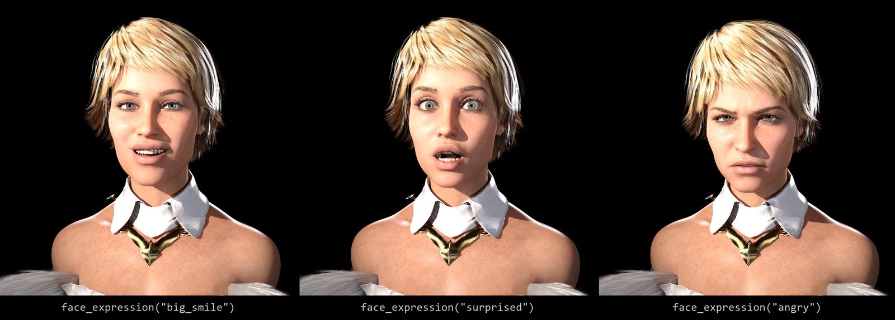
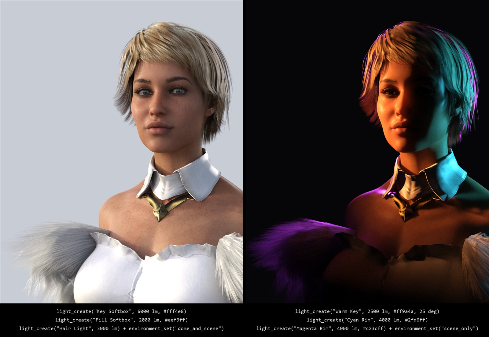
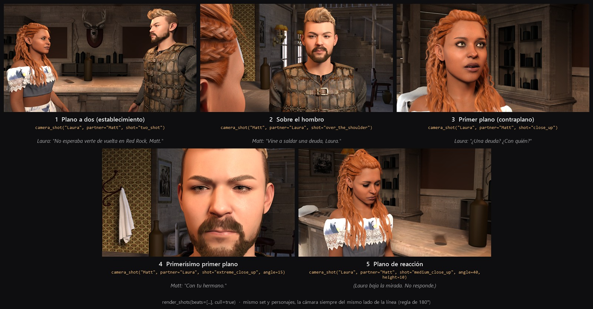
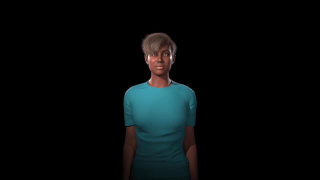
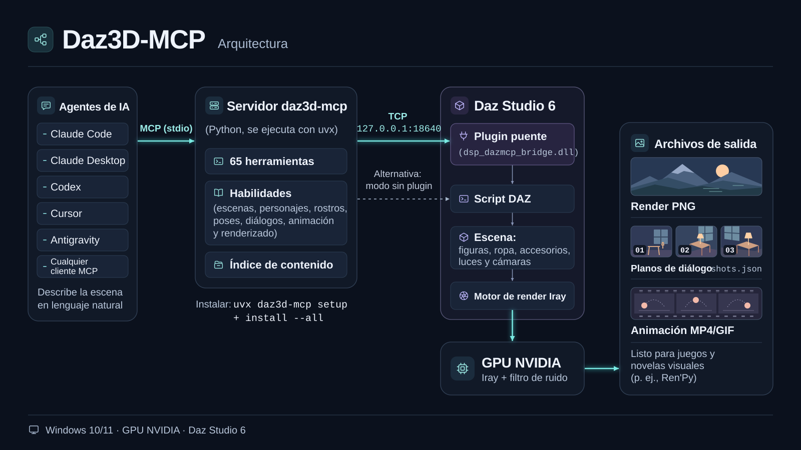

<p align="center">
  
</p>

# Daz3D-MCP

Permite que agentes de IA (Claude Code, Codex, Cursor, Antigravity, Gemini CLI,
Claude Desktop, VS Code y cualquier cliente MCP) controlen **Daz Studio**:
abrir y guardar escenas, buscar el contenido instalado, crear personajes
(forma, ropa, pelo, poses), preparar cámaras, luces y materiales, renderizar con
Iray, instalar contenido de otras tiendas, importar modelos OBJ y FBX, animar
figuras (keyframes, presets, FBX de Mixamo y BVH de captura de movimiento) y
ejecutar DazScript.

> Proyecto open source independiente. No está afiliado ni respaldado por Daz 3D.
> [Read in English](https://github.com/MictlanLabs/Daz3D-MCP/blob/main/README.md)

> **Proyecto nuevo.** Está probado en Daz Studio 6.26 con Windows 11 y una
> tarjeta NVIDIA, pero puede tener detalles por pulir. Reporta los problemas en
> [Issues](https://github.com/MictlanLabs/Daz3D-MCP/issues).

## Ejemplos

Todas estas imágenes las renderizó en Daz Studio un agente de IA con estas herramientas.

### Caras y expresiones

`face_expression` pone expresiones con nombre en figuras Genesis 9 y 8.1;
`eyes_look_at` y `eye_color` se encargan de los ojos.



### Iluminación

`light_create` y `environment_set` arman desde una iluminación de estudio suave
hasta un retrato oscuro con luces de neón.



### Escenas de diálogo

`camera_shot` encuadra primeros planos, planos sobre el hombro y planos a dos
respetando la regla de 180 grados, y `render_shots` renderiza una conversación
entera, una imagen por línea, para novelas visuales, cómics y storyboards.



### Animación

`anim_keys_set`, los presets de animación y la importación de FBX de Mixamo o
BVH animan figuras; `render_animation` renderiza cada fotograma a un MP4 o GIF.

<p align="center">
  
</p>

## Requisitos

- **Windows 10 u 11 de 64 bits.** No hay versión para macOS ni está planeada:
  Daz Studio renderiza con NVIDIA Iray, y las Mac no pueden usar tarjetas NVIDIA.
- **Una tarjeta gráfica NVIDIA** (se recomienda RTX). Iray solo renderiza con
  GPUs NVIDIA, y solo si la escena cabe en la memoria de la tarjeta. Con
  gráficos AMD o Intel, Iray usa la CPU: es muy lento, no tiene el denoiser con
  IA, y las escenas grandes pueden quedarse sin memoria y congelar Daz Studio.
  Solo `render`, `render_shots` y `render_animation` necesitan la GPU; todo lo
  demás funciona con cualquier tarjeta.
- **[Daz Studio 6](https://www.daz3d.com/get_studio)** (gratis), instalado en su
  carpeta predeterminada. Daz Studio 4.24 aún no está soportado.
- **[uv](https://docs.astral.sh/uv/getting-started/installation/)**, que ejecuta
  el servidor MCP e instala Python si hace falta. En PowerShell:

  ```powershell
  powershell -ExecutionPolicy ByPass -c "irm https://astral.sh/uv/install.ps1 | iex"
  ```

  Después abre una terminal nueva para que `uvx` esté en el PATH.
- Un cliente MCP: Claude Code, Claude Desktop, Codex, Cursor, Gemini CLI,
  Antigravity, Windsurf, VS Code (Copilot) o cualquier otro.

## Instalación

**1. Cierra Daz Studio** e instálale el plugin puente:

```powershell
uvx daz3d-mcp setup
```

Encuentra Daz Studio, descarga el plugin de esta versión desde el
[release de GitHub](https://github.com/MictlanLabs/Daz3D-MCP/releases) y lo
copia a `C:\Program Files\DAZ 3D\DAZStudio6\plugins\`. Esa carpeta está
protegida, así que Windows pide permiso de administrador una vez (acéptalo).

**2. Registra el servidor MCP y las skills en tus agentes:**

```powershell
uvx daz3d-mcp install --all
```

Configura todos los agentes compatibles que encuentre en esta computadora y
copia las skills (guías que enseñan al agente a usar Daz) a los agentes que
las leen. Para un solo agente usa `--client NOMBRE` (`claude-code`, `codex`,
`cursor`, `antigravity`, `gemini-cli`, `claude-desktop`, `windsurf`, `vscode`).

**3. Abre Daz Studio, reinicia tus agentes y comprueba:**

```powershell
uvx daz3d-mcp doctor
```

Te dice qué falta y cómo arreglarlo. Luego pídele a tu agente algo como
*"Describe la escena abierta en Daz y muéstrame una captura."*

### Agregarlo a mano

`install` lo hace por ti; usa esto para clientes que `install` no conoce.
Todos los clientes ejecutan el mismo comando, `uvx daz3d-mcp`:

- **Claude Code:**

  ```powershell
  claude mcp add --scope user daz3d -- uvx daz3d-mcp
  ```

- **Codex** (`~/.codex/config.toml`):

  ```toml
  [mcp_servers.daz3d]
  command = "uvx"
  args = ["daz3d-mcp"]
  startup_timeout_sec = 60
  tool_timeout_sec = 600
  ```

- **Claude Desktop, Cursor, Windsurf, Gemini CLI, Antigravity** y la mayoría de
  los clientes (`mcpServers` en su configuración JSON):

  ```json
  { "mcpServers": { "daz3d": { "command": "uvx", "args": ["daz3d-mcp"] } } }
  ```

- Claude Desktop guarda su archivo en `%LOCALAPPDATA%\Claude-Data\<carpeta>\claude_desktop_config.json`
  (versiones anteriores: `%APPDATA%\Claude\claude_desktop_config.json`).
- **VS Code** (`mcp.json`): la misma entrada dentro de `"servers"`, con
  `"type": "stdio"`.

Los clientes sin soporte de skills reciben las mismas guías por el propio MCP
(la herramienta `daz_guide`, prompts y resources).

### Actualizar

uvx conserva la versión que descargó. Para pasar a la más reciente, cierra Daz
Studio y tus agentes, y luego:

```powershell
uv cache clean daz3d-mcp
uvx daz3d-mcp setup
```

`setup` instala el plugin que corresponde a la nueva versión.

### Desinstalar

```powershell
uvx daz3d-mcp uninstall
```

quita las entradas del MCP y las skills que agregó. Borra
`C:\Program Files\DAZ 3D\DAZStudio6\plugins\dsp_dazmcp_bridge.dll` (con Daz
Studio cerrado) para quitar el plugin, y `%USERPROFILE%\.daz3d-mcp` para la
configuración, el token y el índice de contenido.

### Solución de problemas

- **`uvx` no se reconoce:** abre una terminal nueva después de instalar uv.
- **`setup` dice que Daz Studio está abierto:** ciérralo; Windows no deja
  reemplazar un plugin que está en uso.
- **Se rechazó el permiso de administrador:** vuelve a ejecutar
  `uvx daz3d-mcp setup`, o hazlo desde una terminal abierta como Administrador.
- **El agente no ve las herramientas:** reinicia el agente después de
  `install` y ejecuta `uvx daz3d-mcp doctor`.
- **Sin plugin:** `uvx daz3d-mcp setup --no-plugin` usa un modo experimental
  que le pide al Daz Studio abierto que ejecute archivos de script. Es más lento
  pero no instala nada en Daz.

## Cómo funciona



- **Plugin puente** (`bridge/`, C++): un servidor mínimo dentro de Daz Studio.
  Solo escucha en `127.0.0.1`, exige un token y ejecuta DazScript en el hilo
  principal.
- **Biblioteca DazScript** (`scripts/`): un script por herramienta; hace el trabajo real.
- **Servidor MCP** (`src/daz3d_mcp/`, Python): las herramientas que usa el agente.
- **Skills** (`skills/`): guías `SKILL.md` que enseñan al agente a usar Daz.

## Herramientas

| Herramienta | Qué hace |
| --- | --- |
| `daz_status` | Comprueba la conexión; versión de Daz y escena abierta |
| `daz_dialog` | Ve y contesta las ventanas emergentes en las que Daz se detiene (¿sobrescribir?, ¿reemplazar?); requiere el plugin 0.2+ |
| `scene_info` | Figuras, ropa, props, cámaras y luces con posición, rotación y tamaño |
| `scene_new` | Vacía la escena (no pierde cambios sin guardar salvo que se pida) |
| `scene_open` | Abre o fusiona una escena `.duf` |
| `scene_save` | Guarda en `.duf` (no sobrescribe otro archivo salvo que se pida) |
| `viewport_capture` | Devuelve un PNG del viewport, opcionalmente desde una cámara o frame |
| `content_libraries` | Lista las bibliotecas de contenido y cuántos archivos tiene el índice |
| `content_search` | Busca figuras, personajes, ropa, pelo, poses, materiales, props y luces instalados |
| `content_thumbnail` | Muestra la miniatura de un archivo de contenido |
| `content_load` | Carga contenido; ajusta ropa y pelo, aplica poses, personajes y materiales a un objetivo |
| `node_set` | Mueve, rota, escala, muestra/oculta, renombra o selecciona un nodo |
| `node_delete` | Borra nodos (y lo que lleva puesto una figura) |
| `figure_info` | Generación, altura, ropa, morphs en uso, huesos posados y superficies de una figura |
| `morph_list` / `morph_set` | Busca y ajusta diales de forma y los controles de pose y cara de la figura |
| `face_expression` | Expresiones con nombre (sonrisa, tristeza, enojo, sorpresa, guiño...) en Genesis 9 y 8.1, o diales de la cara por nombre |
| `eyes_look_at` | Hace que los ojos (y parte de la cabeza) miren a una cámara, a otra figura o a un punto |
| `eye_color` | Color del iris (lo blanco del ojo no se toca), los 16 iris de Genesis 9, un color por ojo; `sclera` cambia el color de lo blanco |
| `character_create` | Crea un personaje a partir de una descripción (cuerpo, estatura, cada detalle de la cara incluidos dientes, orejas y nariz, piel, ojos, pelo, cejas, vello facial, ropa, añadidos) y lo guarda como ficha de personaje editable (JSON) más un preset de personaje de Daz; los rasgos se traducen a los diales instalados en la generación de la figura y se reportan los que faltan |
| `morph_generate` | Crea diales de forma nuevos para rasgos que el usuario no tiene instalados (20 diales: nariz, barbilla, mandíbula, mejillas, orejas, edad, peso, músculo... en Genesis 9 y 8 / 8.1) a partir de la malla y los pesos de huesos de la figura, los guarda en una biblioteca de contenido y hace que la ropa, el pelo, las cejas y las pestañas los sigan |
| `character_load` / `character_update` / `character_list` | Pone un personaje guardado en cualquier escena (Genesis 9, 8.1 u 8) / cambia solo lo que se pide / lista los personajes y el vocabulario de rasgos |
| `pose_bones` / `pose_reset` | Rota huesos (avisa de los que topan con su límite) / vuelve a la pose por defecto |
| `prop_surfaces` | Mide dónde se puede sentar, acostar o parar una figura sobre un mueble: altura, tamaño, hacia dónde mira un asiento |
| `place_on` | Pone una figura ya posada sobre un asiento, cama o escalón: mirando al frente, contra el respaldo, la cadera sobre el cojín |
| `fit_check` | Por parte del cuerpo: cuánto se mete en un mueble (y por dónde sale) o cuánto flota |
| `wearable_fit` | Ajusta ropa o pelo a una figura, o lo desajusta |
| `package_inspect` / `package_install` | Revisa un .zip de otra tienda e instala su contenido en una biblioteca |
| `package_list` / `package_uninstall` | Lista los paquetes instalados / borra exactamente los archivos que instaló uno |
| `content_add_library` | Agrega una carpeta a las bibliotecas de contenido de Daz Studio |
| `mesh_inspect` / `import_mesh` | Lee un OBJ o FBX (tamaño, unidades, texturas) / lo importa al tamaño correcto, sin diálogos |
| `wearable_from_mesh` | Convierte una prenda importada en ropa que sigue a una figura (Transfer Utility) |
| `wearable_refit` | Revisa y repara ropa y zapatos hechos para otra generación de Genesis tras el Auto-Fit, una prenda o todo lo que viste una figura: reconstruye las prendas que quedaron con los huesos o la forma de la otra generación (Transfer Utility con el clon) y, en zapatos, pone los pies en la pose que pide el archivo del zapato, conserva su forma, restaura sus pesos y apoya la figura sobre las suelas |
| `wearable_adjust` | Suavizado y colisión de la ropa (corrige la piel que atraviesa la tela) |
| `anim_timeline` | Fotogramas por segundo, rango, frame actual y qué está animado |
| `anim_keys_set` / `anim_keys_get` / `anim_keys_delete` | Keyframes en huesos, cadera, nodos, morphs y cualquier propiedad numérica |
| `anim_key_pose` | Pone keys de la pose actual (de `pose_bones` o un preset de pose) en unos frames |
| `anim_sample` | Posición en el mundo de los huesos en unos frames, para revisar un movimiento |
| `anim_preview` | Imágenes del viewport de varios frames |
| `anim_foot_contact` | Detecta pies que atraviesan el piso, flotan o resbalan; puede corregir la altura de la cadera |
| `anim_retime` / `anim_offset` | Más rápido, más lento o a una duración / más tarde, movido, girado o en un punto |
| `anim_preset_list` / `anim_preset_save` / `anim_preset_apply` | Presets de animación: incluidos, propios (en bucle, repetidos) y .duf comprados |
| `anim_file_inspect` / `anim_import` | Lee un BVH o FBX binario (Mixamo, CMU...) y lo adapta a una figura Genesis con un mapa de huesos |
| `camera_create` / `camera_set` | Crea o cambia una cámara; puede encuadrar nodos sola |
| `camera_shot` | Encuadra un plano de cine sobre una cara (primer plano, sobre el hombro, plano a dos) respetando la regla de 180 grados |
| `light_create` / `light_set` | Crea o cambia luces spot, point y distant |
| `environment_set` | Domo de Iray, HDRI y sol-cielo |
| `material_list` / `material_set` | Lee y cambia superficies (colores, rugosidad, texturas) |
| `render_settings` | Tamaño de imagen y límites de Iray |
| `render` | Renderiza a un archivo y devuelve la imagen |
| `render_shots` | Renderiza una conversación como serie de planos (caras, miradas y cámara por línea) para novelas visuales |
| `render_cull` | Deja fuera del render lo que la cámara no ve (fuera de cuadro, detrás de ella, ropa bajo otra ropa) y conserva lo que aún afecta a la luz; `cull=true` en `render`, `render_shots` y `render_animation` lo hace por plano |
| `render_animation` | Renderiza cada cuadro de la animación y los une en un MP4 o GIF |
| `run_script` | Ejecuta DazScript para todo lo demás (se puede desactivar) |
| `daz_guide` | Devuelve las skills como texto para agentes sin soporte de skills |

Skills: `daz-basics`, `scene-building`, `characters`, `faces`, `furniture-poses`, `character-design`, `dialogue-scenes`, `rendering`, `render-culling`, `cross-generation-clothing`, `third-party-assets`, `animation`.

Pruébalo: *"Abre ~/Documents/escena.duf en Daz, describe la escena y muéstrame una captura."*
O: *"Monta una escena con dos personajes Genesis 9, vestidos y posados,
conversando, y renderízala."*
O: *"Crea a Ana para mi novela visual: 1.65 m, labios carnosos, ojos verdes
rasgados, pecas, separación entre los dientes de enfrente, pelo largo trenzado.
Guárdala para usarla en todas las escenas."*
O: *"Instala ~/Downloads/chaqueta.zip, viste a Ana con ella, luego importa
~/Downloads/capa.fbx y conviértela en ropa que la siga."*
O: *"Haz que Ana camine cuatro pasos hacia la cámara y luego pon en Leo
~/Downloads/Dancing.fbx de Mixamo desde el frame 60."*

La búsqueda de contenido corre en el servidor MCP sobre un índice de los
archivos de la biblioteca (`~/.daz3d-mcp/content-index.json`, se reconstruye
cada 24 horas o con `refresh_index=true`), así que una búsqueda nunca congela
Daz Studio.

## Configuración

`~/.daz3d-mcp/settings.json` (lo crea `setup`):

| Clave | Por defecto | Significado |
| --- | --- | --- |
| `allow_run_script` | `true` | Permite la herramienta libre `run_script` |
| `transport` | `"auto"` | `auto`, `http` (solo plugin) o `file` (modo sin plugin) |
| `daz_executable` | detectado | Ejecutable de Daz Studio, para el modo sin plugin |
| `timeout` | `600` | Segundos de espera por petición |
| `render_timeout` | `3600` | Segundos de espera por render |
| `render_dir` | `~/.daz3d-mcp/renders` | Dónde van los renders sin ruta |
| `ffmpeg` | detectado | ffmpeg que usa `render_animation` para los vídeos (PATH, luego el que trae Daz Studio) |
| `content_libraries` | `[]` | Carpetas de biblioteca extra para buscar |
| `content_index_max_age_hours` | `24` | Cada cuánto se reconstruye el índice de contenido |
| `install_library` | `~/Documents/DAZ 3D/Third Party Library` | Dónde instala `package_install` los paquetes |
| `max_package_gb` | `20` | Paquete más grande (descomprimido) que acepta `package_install` |
| `characters_dir` | `~/.daz3d-mcp/characters` | Dónde se guardan las fichas de personaje (`.json`) y sus presets de Daz (`.duf`) |
| `dialog_rules` | `[]` | Respuestas a diálogos de Daz dadas de antemano, p. ej. `[{"match": "outside the limits", "button": "Turn Limits Off"}]` (plugin 0.2+) |
| `rotation_convention` | medida | Cómo gira Daz los huesos; el primer `anim_import` la mide y la guarda en `~/.daz3d-mcp/animation.json` |

## Seguridad

El puente solo escucha en `127.0.0.1`, exige el token aleatorio guardado en
`~/.daz3d-mcp/token` (solo tú puedes leerlo) y rechaza peticiones de
navegadores. `run_script` le da al agente el mismo poder que un DazScript que
ejecutes tú; pon `allow_run_script` en `false` si no lo quieres.

## Desarrollo

```bash
uv run --group dev pytest            # pruebas de Python y DazScript (Node.js ejecuta los scripts contra un Daz simulado)
npm install --prefix tests/fake_daz  # una vez, para revisar la sintaxis ES5
```

Compilar el puente: ver [bridge/README.md](https://github.com/MictlanLabs/Daz3D-MCP/blob/main/bridge/README.md).
El protocolo del puente está en [docs/protocol.md](https://github.com/MictlanLabs/Daz3D-MCP/blob/main/docs/protocol.md).

### Versiones

La versión del paquete vive solo en `pyproject.toml`; `daz3d_mcp.__version__`
(la que muestran `daz_status` y `daz3d-mcp --version`) se lee de ahí. Súbela
con uv, que también actualiza `uv.lock`, y agrega la versión a
[CHANGELOG.md](https://github.com/MictlanLabs/Daz3D-MCP/blob/main/CHANGELOG.md) y a [CHANGELOG.es.md](https://github.com/MictlanLabs/Daz3D-MCP/blob/main/CHANGELOG.es.md):

```bash
uv version --bump patch   # 0.5.0 -> 0.5.1
uv version --bump minor   # 0.5.0 -> 0.6.0
```

Desde la 1.0.0 las versiones siguen [Semantic Versioning](https://semver.org/lang/es/):
**patch** para correcciones, **minor** para herramientas o skills nuevas,
**major** para cambios incompatibles (una herramienta que se quita o se
renombra, un argumento que cambia de significado).

El plugin puente tiene su propia versión en `bridge/src/version.h`; súbela solo
cuando cambie el plugin, y sube `DAZMCP_PROTOCOL_VERSION` (y `PROTOCOL_VERSION`
en `src/daz3d_mcp/__init__.py`) solo cuando cambie el formato HTTP.

### Publicar una versión

`setup` descarga el plugin del release de GitHub `v<versión>` de la versión
exacta del paquete, así que cada release necesita el plugin adjunto, aunque el
plugin no haya cambiado. Publica el release de GitHub antes que PyPI, para que
`setup` funcione en cuanto aparezca el paquete.

1. Sube la versión y llena los dos changelogs; corre las pruebas.
2. Compila el puente si cambió ([bridge/README.md](https://github.com/MictlanLabs/Daz3D-MCP/blob/main/bridge/README.md)).
3. Haz commit, crea el tag y súbelo: `git tag v1.2.3` y `git push origin main v1.2.3`.
4. Crea el release de GitHub `v1.2.3` desde ese tag, con la sección del
   changelog como notas, y adjunta `build/bridge/Release/dsp_dazmcp_bridge.dll`
   renombrado a `dazmcp_bridge-ds6-windows-x64.dll`.
5. Construye y sube el paquete (con un token de API de PyPI, o `UV_PUBLISH_TOKEN`):

   ```bash
   uv build
   uv publish
   ```

## Licencia

Apache 2.0. Ver [LICENSE](https://github.com/MictlanLabs/Daz3D-MCP/blob/main/LICENSE). El SDK de Daz Studio no se incluye.
