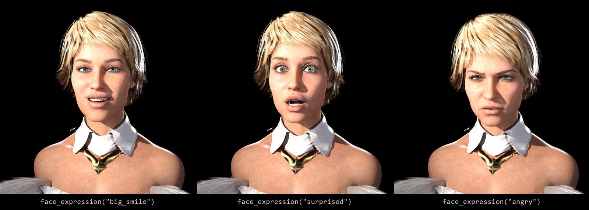
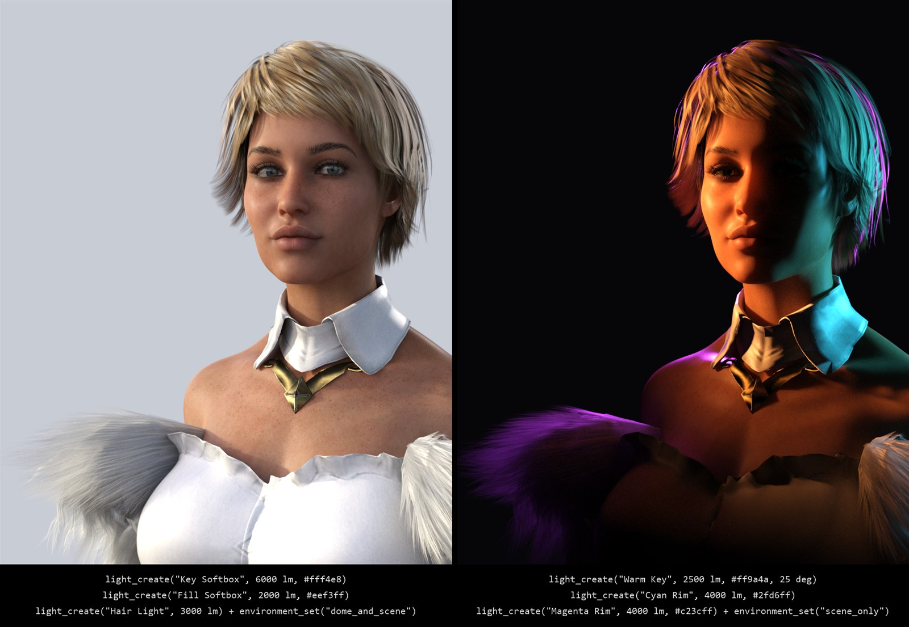
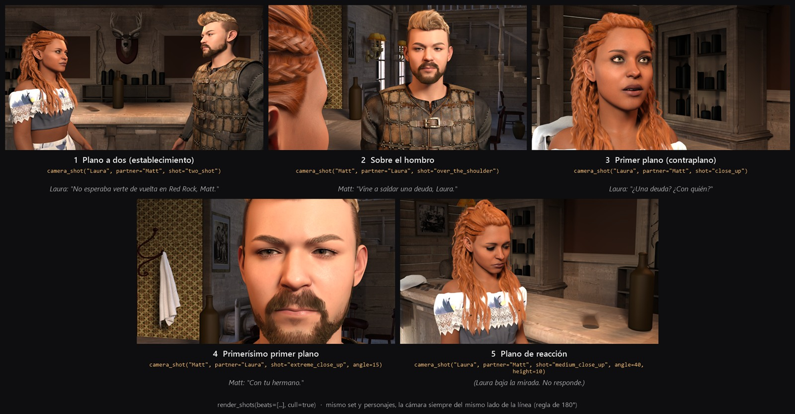
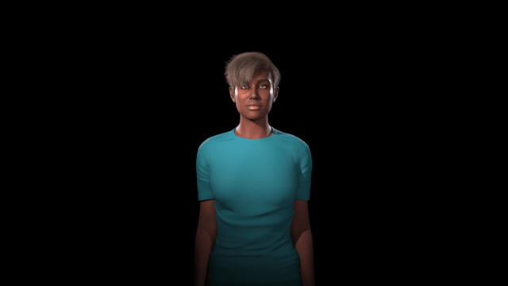
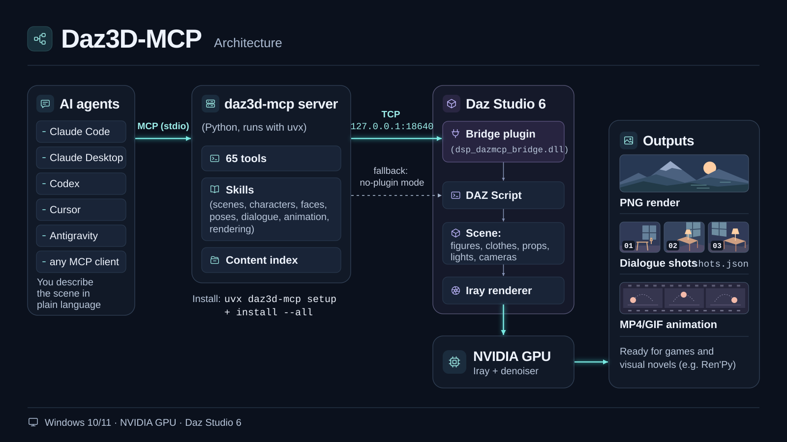

<p align="center">
  
</p>

# Daz3D-MCP

Let AI agents (Claude Code, Codex, Cursor, Antigravity, Gemini CLI, Claude
Desktop, VS Code and any other MCP client) control **Daz Studio**: open and
save scenes, find installed content, build characters (shape, clothing, hair,
poses), set up cameras, lights and materials, render with Iray, install content
from other stores, import OBJ and FBX models, animate figures (keyframes,
presets, Mixamo FBX and mocap BVH), and run DazScript.

> Independent open source project. Not affiliated with or endorsed by Daz 3D.
> [Leer en español](https://github.com/MictlanLabs/Daz3D-MCP/blob/main/README.es.md)

> **New project.** It is tested on Daz Studio 6.26 on Windows 11 with an NVIDIA
> card, but expect rough edges. Please report problems in
> [Issues](https://github.com/MictlanLabs/Daz3D-MCP/issues).

## Examples

Every image here was rendered in Daz Studio by an AI agent using these tools.

### Faces and expressions

`face_expression` puts named expressions on Genesis 9 and 8.1 figures;
`eyes_look_at` and `eye_color` take care of the eyes.



### Lighting

`light_create` and `environment_set` build anything from a soft studio setup to
a low-key neon portrait.



### Dialogue scenes

`camera_shot` frames close-ups, over-the-shoulder shots and two shots that keep
the 180 degree rule, and `render_shots` renders a whole conversation, one image
per line, for visual novels, comics and storyboards.



### Animation

`anim_keys_set`, animation presets and Mixamo FBX or BVH import animate
figures; `render_animation` renders every frame to an MP4 or GIF.

<p align="center">
  
</p>

## Requirements

- **Windows 10 or 11, 64-bit.** There is no macOS version and none is planned:
  Daz Studio renders with NVIDIA Iray, and Macs cannot use NVIDIA cards.
- **An NVIDIA graphics card** (RTX recommended). Iray only renders on NVIDIA
  GPUs, and only when the scene fits in the card's memory. On AMD or Intel
  graphics Iray falls back to the CPU: very slow, without the AI denoiser, and
  big scenes can run out of memory and hang Daz Studio. Only `render`,
  `render_shots` and `render_animation` need the GPU; everything else works on
  any card.
- **[Daz Studio 6](https://www.daz3d.com/get_studio)** (free), installed in its
  default folder. Daz Studio 4.24 is not supported yet.
- **[uv](https://docs.astral.sh/uv/getting-started/installation/)**, which runs
  the MCP server and installs Python for it if needed. In PowerShell:

  ```powershell
  powershell -ExecutionPolicy ByPass -c "irm https://astral.sh/uv/install.ps1 | iex"
  ```

  Open a new terminal afterwards so `uvx` is on the PATH.
- An MCP client: Claude Code, Claude Desktop, Codex, Cursor, Gemini CLI,
  Antigravity, Windsurf, VS Code (Copilot) or any other.

## Install

**1. Close Daz Studio**, then install the bridge plugin into it:

```powershell
uvx daz3d-mcp setup
```

It finds Daz Studio, downloads the plugin that matches this version from the
[GitHub release](https://github.com/MictlanLabs/Daz3D-MCP/releases) and copies
it to `C:\Program Files\DAZ 3D\DAZStudio6\plugins\`. That folder is protected,
so Windows asks for administrator permission once (accept the prompt).

**2. Register the MCP server and the skills in your agents:**

```powershell
uvx daz3d-mcp install --all
```

It configures every supported agent it finds on this computer and copies the
skills (guides that teach the agent how to use Daz) into the agents that read
them. For one agent only, use `--client NAME` (`claude-code`, `codex`,
`cursor`, `antigravity`, `gemini-cli`, `claude-desktop`, `windsurf`, `vscode`).

**3. Open Daz Studio, restart your agents, and check:**

```powershell
uvx daz3d-mcp doctor
```

It says what is missing and how to fix it. Then ask your agent something like
*"Describe the scene open in Daz and show me a capture."*

### Adding it by hand

`install` does this for you; use it for clients `install` does not know.
Every client runs the same command, `uvx daz3d-mcp`:

- **Claude Code:**

  ```powershell
  claude mcp add --scope user daz3d -- uvx daz3d-mcp
  ```

- **Codex** (`~/.codex/config.toml`):

  ```toml
  [mcp_servers.daz3d]
  command = "uvx"
  args = ["daz3d-mcp"]
  startup_timeout_sec = 60
  tool_timeout_sec = 600
  ```

- **Claude Desktop, Cursor, Windsurf, Gemini CLI, Antigravity** and most other
  clients (`mcpServers` in their JSON settings):

  ```json
  { "mcpServers": { "daz3d": { "command": "uvx", "args": ["daz3d-mcp"] } } }
  ```

- Claude Desktop keeps its file in `%LOCALAPPDATA%\Claude-Data\<folder>\claude_desktop_config.json`
  (older versions: `%APPDATA%\Claude\claude_desktop_config.json`).
- **VS Code** (`mcp.json`): the same entry under `"servers"`, with
  `"type": "stdio"`.

Clients without skills support get the same guides through the MCP itself
(the `daz_guide` tool, prompts and resources).

### Update

uvx keeps the version it downloaded. To move to the latest one, close Daz
Studio and your agents, then:

```powershell
uv cache clean daz3d-mcp
uvx daz3d-mcp setup
```

`setup` installs the plugin that matches the new version.

### Uninstall

```powershell
uvx daz3d-mcp uninstall
```

removes the MCP entries and skills it added. Delete
`C:\Program Files\DAZ 3D\DAZStudio6\plugins\dsp_dazmcp_bridge.dll` (with Daz
Studio closed) to remove the plugin, and `%USERPROFILE%\.daz3d-mcp` for the
settings, token and content index.

### Troubleshooting

- **`uvx` is not recognized:** open a new terminal after installing uv.
- **`setup` says Daz Studio is open:** close it; Windows does not let a
  plugin in use be replaced.
- **The permission prompt was refused:** run `uvx daz3d-mcp setup` again, or
  from a terminal opened as Administrator.
- **The agent does not see the tools:** restart the agent after `install`, and
  run `uvx daz3d-mcp doctor`.
- **No plugin at all:** `uvx daz3d-mcp setup --no-plugin` uses an experimental
  mode that asks the running Daz Studio to execute script files. It is slower
  but needs nothing installed in Daz.

## How it works



- **Bridge plugin** (`bridge/`, C++): a tiny server inside Daz Studio. It only
  listens on `127.0.0.1`, needs a token and runs DazScript on the main thread.
- **DazScript library** (`scripts/`): one script per tool; it does the real work.
- **MCP server** (`src/daz3d_mcp/`, Python): the tools agents call.
- **Skills** (`skills/`): `SKILL.md` guides that teach agents how to use Daz.

## Tools

| Tool | What it does |
| --- | --- |
| `daz_status` | Checks the connection; Daz version and open scene |
| `daz_dialog` | Sees and answers pop-up dialogs Daz stops on (overwrite?, replace?); needs plugin 0.2+ |
| `scene_info` | Figures, clothing, props, cameras and lights with position, rotation, size |
| `scene_new` | Clears the scene (refuses to lose unsaved work unless told) |
| `scene_open` | Opens or merges a `.duf` scene |
| `scene_save` | Saves as `.duf` (never overwrites another file unless told) |
| `viewport_capture` | Returns a PNG of the viewport, optionally from a camera or frame |
| `content_libraries` | Lists the content libraries and how many files the index holds |
| `content_search` | Finds installed figures, characters, clothing, hair, poses, materials, props, lights |
| `content_thumbnail` | Shows a content file's thumbnail |
| `content_load` | Loads content; fits clothing and hair, applies poses, characters and materials to a target |
| `node_set` | Moves, rotates, scales, shows/hides, renames or selects a node |
| `node_delete` | Deletes nodes (and what is fitted to a figure) |
| `figure_info` | A figure's generation, height, clothing, morphs in use, posed bones and surfaces |
| `morph_list` / `morph_set` | Finds and sets shape dials and the figure's pose and face controls |
| `face_expression` | Named expressions (smile, sad, angry, surprised, wink...) on Genesis 9 and 8.1, or face dials by name |
| `eyes_look_at` | Aims the eyes (and part of the head turn) at a camera, another figure or a point |
| `eye_color` | Iris color only, the whites stay white; Genesis 9's 16 iris images; one color per eye |
| `pose_bones` / `pose_reset` | Rotates bones (reports dials held at joint limits) / back to the default pose |
| `prop_surfaces` | Measures where a figure can sit, lie or stand on a prop: height, size, which way a seat faces |
| `place_on` | Puts a posed figure on a seat, bed or step: faces it out, against the backrest, hips on the cushion |
| `fit_check` | Per body part: how deep it goes into furniture (and which way is out) or how far it floats |
| `wearable_fit` | Fits clothing or hair to a figure, or unfits it |
| `package_inspect` / `package_install` | Looks inside a .zip from another store and installs its content into a library |
| `package_list` / `package_uninstall` | Lists installed packages / removes exactly the files one installed |
| `content_add_library` | Adds a folder to Daz Studio's content libraries |
| `mesh_inspect` / `import_mesh` | Reads an OBJ or FBX (size, units, textures) / imports it at the right size, without dialogs |
| `wearable_from_mesh` | Turns an imported garment into clothing that follows a figure (Transfer Utility) |
| `wearable_refit` | Checks and repairs clothing and shoes made for another Genesis generation after Auto-Fit, one item or everything a figure wears: rebuilds pieces left in the old generation's bones or shape (Transfer Utility with the clone), and for shoes poses the feet as the shoe's file asks, keeps the shoe's shape, restores its weights, stands the figure on its soles |
| `wearable_adjust` | Mesh smoothing and collision of clothing (fixes skin poking through) |
| `anim_timeline` | Frame rate, frame range, current frame, and what is animated |
| `anim_keys_set` / `anim_keys_get` / `anim_keys_delete` | Keyframes on bones, the hip, nodes, morphs and any number property |
| `anim_key_pose` | Keys the current pose (from `pose_bones` or a pose preset) at some frames |
| `anim_sample` | World positions of bones at some frames, to check a motion |
| `anim_preview` | Viewport images of several frames |
| `anim_foot_contact` | Finds feet through the floor, floating and sliding; can fix the hip height |
| `anim_retime` / `anim_offset` | Faster, slower or a set length / later, moved, turned or put on a spot |
| `anim_preset_list` / `anim_preset_save` / `anim_preset_apply` | Animation presets: built-in, your own (looping, repeated) and bought .duf ones |
| `anim_file_inspect` / `anim_import` | Reads a BVH or binary FBX (Mixamo, CMU...) and adapts it to a Genesis figure with a bone map |
| `camera_create` / `camera_set` | Adds or changes a camera; can frame nodes automatically |
| `camera_shot` | Frames a film shot on a face (close-up, over the shoulder, two shot) keeping the 180 degree rule |
| `light_create` / `light_set` | Adds or changes spot, point and distant lights |
| `environment_set` | Iray dome, HDRI and sun-sky |
| `material_list` / `material_set` | Reads and changes surfaces (colors, roughness, texture maps) |
| `render_settings` | Image size and Iray limits |
| `render` | Renders to a file and returns the image |
| `render_shots` | Renders a conversation as a series of shots (faces, gazes and camera per line) for visual novels |
| `render_cull` | Leaves out of the render what a camera cannot see (out of frame, behind it, clothing under clothing), keeping what still shapes the light; `cull=true` on `render`, `render_shots` and `render_animation` does it per shot |
| `render_animation` | Renders every frame of the animation and joins them into an MP4 or GIF |
| `run_script` | Runs DazScript for anything else (can be disabled) |
| `daz_guide` | Returns the skills as text for agents without skills support |

Skills: `daz-basics`, `scene-building`, `characters`, `faces`, `furniture-poses`, `dialogue-scenes`, `rendering`, `render-culling`, `cross-generation-clothing`, `third-party-assets`, `animation`.

Try it: *"Open ~/Documents/scene.duf in Daz, describe the scene and show me a capture."*
Or: *"Build a scene with two Genesis 9 characters, dressed and posed, talking
to each other, and render it."*
Or: *"Install ~/Downloads/jacket.zip, dress Ana with it, then import
~/Downloads/cape.fbx and make it clothing that follows her."*
Or: *"Make Ana walk four steps toward the camera, then put
~/Downloads/Dancing.fbx from Mixamo on Leo starting at frame 60."*

Content search runs in the MCP server on an index of the library files
(`~/.daz3d-mcp/content-index.json`, rebuilt every 24 hours or with
`refresh_index=true`), so Daz Studio is never frozen by a search.

## Settings

`~/.daz3d-mcp/settings.json` (created by `setup`):

| Key | Default | Meaning |
| --- | --- | --- |
| `allow_run_script` | `true` | Allow the free-form `run_script` tool |
| `transport` | `"auto"` | `auto`, `http` (plugin only) or `file` (no-plugin mode) |
| `daz_executable` | detected | Daz Studio binary, for no-plugin mode |
| `timeout` | `600` | Seconds to wait for one request |
| `render_timeout` | `3600` | Seconds to wait for one render |
| `render_dir` | `~/.daz3d-mcp/renders` | Where renders go when no path is given |
| `ffmpeg` | detected | ffmpeg used by `render_animation` for videos (PATH, then the one Daz Studio ships) |
| `content_libraries` | `[]` | Extra library folders to search |
| `content_index_max_age_hours` | `24` | When to rebuild the content index |
| `install_library` | `~/Documents/DAZ 3D/Third Party Library` | Where `package_install` puts packages |
| `max_package_gb` | `20` | Largest package (unpacked) `package_install` accepts |
| `dialog_rules` | `[]` | Answers to Daz dialogs given in advance, e.g. `[{"match": "outside the limits", "button": "Turn Limits Off"}]` (plugin 0.2+) |
| `rotation_convention` | measured | How Daz turns bones; the first `anim_import` measures it and caches it in `~/.daz3d-mcp/animation.json` |

## Security

The bridge listens on `127.0.0.1` only, requires the random token stored in
`~/.daz3d-mcp/token` (readable only by you) and rejects browser requests.
`run_script` gives an agent the same power as a DazScript you run yourself;
set `allow_run_script` to `false` if you do not want that.

## Development

```bash
uv run --group dev pytest            # Python + DazScript tests (Node.js runs the scripts against a fake Daz)
npm install --prefix tests/fake_daz  # once, for the ES5 syntax checks
```

Building the bridge: see [bridge/README.md](https://github.com/MictlanLabs/Daz3D-MCP/blob/main/bridge/README.md).
The bridge protocol is documented in [docs/protocol.md](https://github.com/MictlanLabs/Daz3D-MCP/blob/main/docs/protocol.md).

### Versioning

The package version lives only in `pyproject.toml`; `daz3d_mcp.__version__`
(shown by `daz_status` and `daz3d-mcp --version`) is read from it. Bump it with
uv, which also updates `uv.lock`, then add the release to
[CHANGELOG.md](https://github.com/MictlanLabs/Daz3D-MCP/blob/main/CHANGELOG.md) and [CHANGELOG.es.md](https://github.com/MictlanLabs/Daz3D-MCP/blob/main/CHANGELOG.es.md):

```bash
uv version --bump patch   # 0.5.0 -> 0.5.1
uv version --bump minor   # 0.5.0 -> 0.6.0
```

From 1.0.0 on, versions follow [Semantic Versioning](https://semver.org/):
**patch** for fixes, **minor** for new tools or skills, **major** for breaking
changes (a tool removed or renamed, an argument that changes meaning).

The bridge plugin has its own version in `bridge/src/version.h`; bump it only
when the plugin changes, and bump `DAZMCP_PROTOCOL_VERSION` (and
`PROTOCOL_VERSION` in `src/daz3d_mcp/__init__.py`) only when the HTTP format
changes.

### Publishing a release

`setup` downloads the plugin from the GitHub release `v<version>` of the exact
package version, so every release needs the plugin attached, even when the
plugin did not change. Publish the GitHub release before PyPI, so `setup`
works as soon as the package appears.

1. Bump the version and fill in both changelogs; run the tests.
2. Build the bridge if it changed ([bridge/README.md](https://github.com/MictlanLabs/Daz3D-MCP/blob/main/bridge/README.md)).
3. Commit, tag and push: `git tag v1.2.3` and `git push origin main v1.2.3`.
4. Create the GitHub release `v1.2.3` from that tag, with the changelog
   section as notes, and attach `build/bridge/Release/dsp_dazmcp_bridge.dll`
   renamed to `dazmcp_bridge-ds6-windows-x64.dll`.
5. Build and upload the package (a PyPI API token, or `UV_PUBLISH_TOKEN`):

   ```bash
   uv build
   uv publish
   ```

## License

Apache 2.0. See [LICENSE](https://github.com/MictlanLabs/Daz3D-MCP/blob/main/LICENSE). The Daz Studio SDK is not included.
